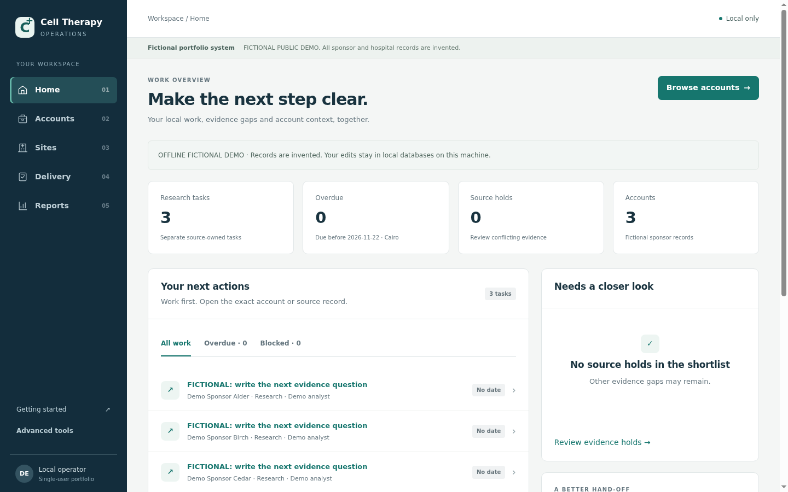

# Cell Therapy Operations

### From scattered research to a clear next step.

A local, single-operator workflow for keeping account context, open questions, site evidence and internal review together. Built as an independent portfolio project, not a clinical service, customer deployment or verified hospital network.

**This public candidate runs offline with invented data.** The three sponsors, three hospitals and practice scenarios are fictional. No accounts, keys, external source downloads or paid services are needed. Nothing is sent to anyone.



[Step-by-step walkthrough](docs/USING-THE-DEMO.md) · [Architecture and limits](docs/TECHNICAL-GUIDE.md) · [Data provenance](docs/DATA-PROVENANCE.md) · [Video notes](docs/VIDEO.md)

## Watch the walkthrough

[Watch the walkthrough on YouTube](https://www.youtube.com/watch?v=nh1IadbJdow)

The V3 walkthrough shows the larger retained-public-research build, not the fictional dataset included here. The source runs locally; there is no hosted app.

## The problem

Useful research does not automatically establish the next action. A company record, a trial update and a site listing can each look promising without answering who owns the next question, what evidence is missing or what should happen before a hand-off.

When that context is split across screens and notes, the same work can get searched, explained and reviewed again. Worse, a neat interface can make an assumption look like a decision: a title becomes a buyer, a registry entry becomes readiness, or a reviewed draft becomes permission to contact someone.

## The approach

Keep the next step beside the context, without hiding uncertainty.

| Destination | What to do |
| --- | --- |
| Home | Start from open work and inspect what needs a decision. |
| Accounts | Keep research context, planning, people gaps, site links and internal review together. |
| Sites | Inspect linked context and record six-axis assessments. Grey means unknown, not ready. |
| Delivery | Prepare a scope, open items and an internal-review checklist, then preview a format-only review. |
| Reports | Inspect recorded local activity and explicitly bounded counts, not invented business outcomes. |

Planning notes use version checks. Same-version stale writes are rejected rather than quietly replacing another edit. Internal copy review does not authorize sending. A delivery checklist does not establish client acceptance.

These are design choices and tested local behaviors, not measured time-saving, conversion or revenue results.

## Run from a fresh folder

### Prerequisites

- Python 3.10 or newer with SQLite and timezone data. This candidate was checked on Python 3.10.12 on Linux. Other Python versions and operating systems have not been independently verified here.
- Bash for the shortcut below. The manual Python commands do not require Bash.
- Port 8080 available on your own machine.

The offline application and its included tests use Python's standard library. There is no package installation step, account setup or API key.

### 1. Open the project folder

Clone the repository and open the project folder:

```sh
git clone https://github.com/mohamed-isaac5/cell-therapy-operations.git
cd cell-therapy-operations
```

Or download the source ZIP from GitHub and open its extracted folder.

### 2. Create fictional data and start

```sh
bash run.sh
```

On first run, the script creates four local SQLite stores containing only new fictional demo records. It never copies the private retained research databases. It refuses a partial database set instead of silently overwriting it.

Open **http://127.0.0.1:8080/home**. Stop with **Ctrl+C** in the terminal. Local edits remain on your machine in gitignored databases.

Without Bash, run these once in a fresh folder:

```sh
python3 bootstrap_demo.py
python3 app.py --port 8080
```

On subsequent starts, run only the second command. The bootstrap refuses to overwrite existing databases. To use another port, pass `--port 8081`, or use `CGT_PORT=8081 bash run.sh` in Bash.

## Try one complete workflow

1. On **Home**, open a fictional sponsor task.
2. In **Accounts**, choose **Demo Sponsor Alder** and open **Work & planning**.
3. Write a next evidence question and a blocker. Save and check the confirmation. Planning does not change evidence or qualification.
4. Open **Evidence** and **People**. These fixtures establish no real programme or named buyer. Unknown is the intended state.
5. In **Sites**, select a demo hospital and inspect its linked context. The assessment starts Grey. Do not use a fictional record to mark a real site ready.
6. In **Delivery**, enter a fictional scope and open items, save the draft and inspect the preview. Internal-review readiness is not external acceptance.
7. Open **Reports** to inspect local activity. Business outcomes are not measured.

[The illustrated walkthrough](docs/USING-THE-DEMO.md) explains what to expect at each step and how to recover from a stale edit.

## What the public demo deliberately does not do

- No live registry, employer-page, CRM or email connection. External refresh is disabled in this candidate.
- No real company evidence, people directory, buyer verification or hospital network.
- No company-specific sales draft is fabricated when the fictional evidence does not establish a premise. The advanced draft/review views correctly show missing-evidence states.
- No sending, payment, booking, scheduling or client acceptance.
- No shared login, staff roles or safe hosted deployment. The server binds to loopback only. Do not expose it to your network or the internet.
- No clinical validation, security audit, accessibility certification or real-user study.

The private retained-research build shown in the earlier portfolio video contains a larger, different dataset. This sanitized candidate demonstrates the same workspace pattern with smaller fictional inputs. It does not pretend the full private research corpus is included.

## Run the checks

```sh
python3 -m unittest -v test_public_candidate
```

The suite starts its own isolated temporary copy on port 8919, creates only fictional fixtures and stops the server afterward. It checks the main and specialist routes, APIs, static assets, fictional-data boundaries, Unknown defaults, planning persistence/conflict behavior, refresh blocking, bootstrap non-overwrite, database integrity and Host-header protection.

**Candidate verification:** 14 automated tests passed on a clean temporary folder. This is a narrower public-candidate suite, not a claim that the earlier 312-test retained-data regression suite ran against these new fixtures. Browser screenshots are inspected separately; no automated browser-test count is claimed for this candidate.

## Repository map

```text
app.py, storage.py           Loopback server and source-work state
operations.py, delivery.py   Account planning, captures and internal hand-off
fit.py, outreach.py          Evidence boundaries and review-only draft logic
committee.py, hospitals.py   Role gaps and site assessments
crm.py, replies.py           Separate fictional practice workflows
reporting.py, dashboard.py   Local activity summaries
workspace.html/css/js       Main five-destination interface
bootstrap_demo.py           New fictional fixture generator, no overwrite
demo-schema.json            Schemas only, no retained data
run.sh                      First-run setup and local startup
test_public_candidate.py    Clean-copy checks
docs/                       Usage, architecture, provenance and screenshots
```

## Media and authorship

Development and editorial production were AI-assisted. Video narration is AI-generated. The optional explainer uses an original locally synthesized music bed, not a downloaded commercial recording. See [video notes](docs/VIDEO.md) for the difference between the video dataset and this public candidate.

## License

MIT, copyright Mohamed Isaac. See [LICENSE](LICENSE). The license applies to the original code, not third-party source material or the separate retained research dataset.
