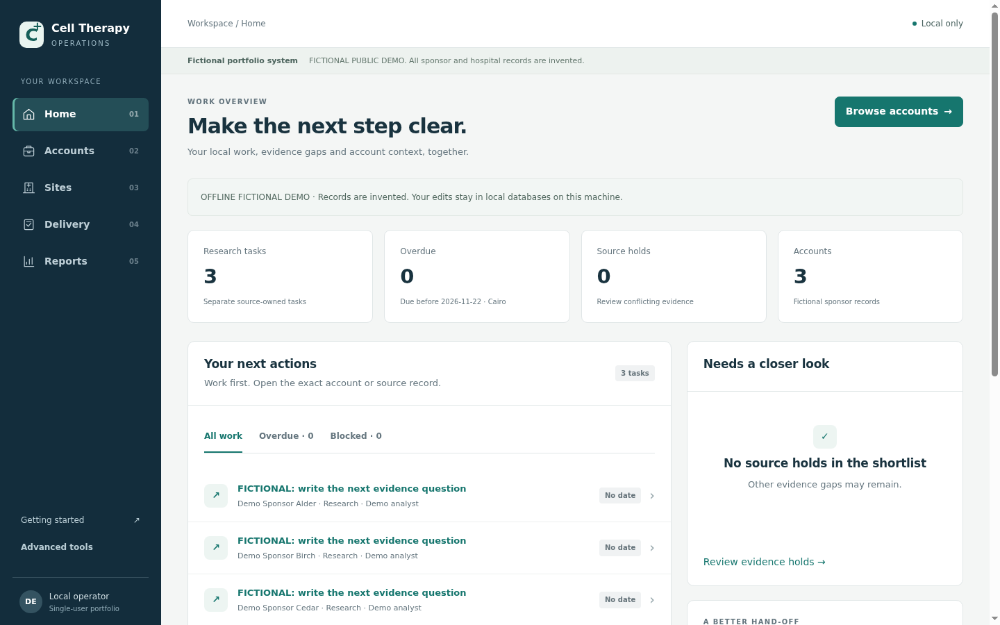
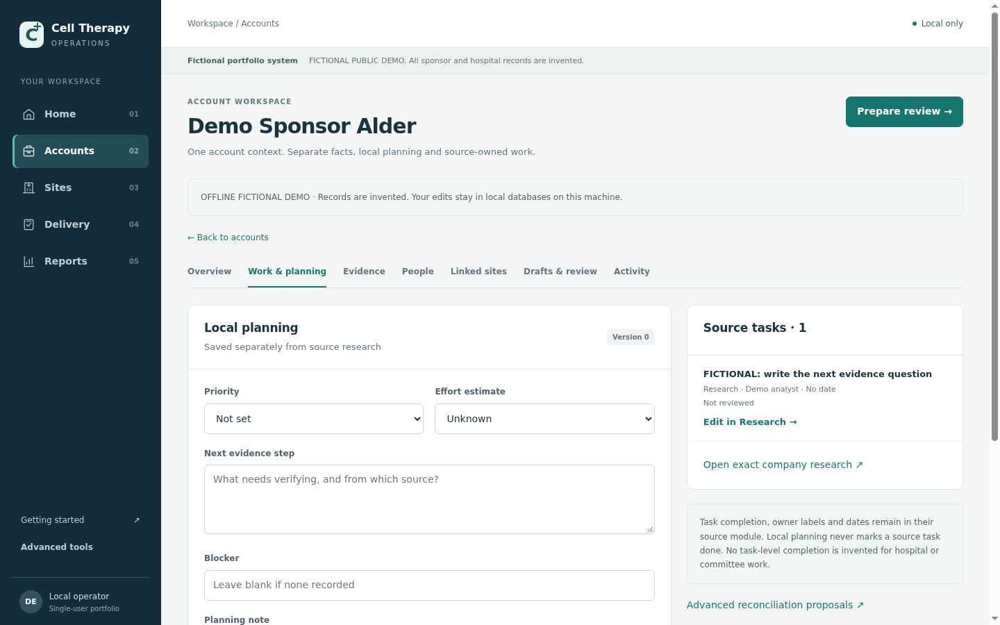
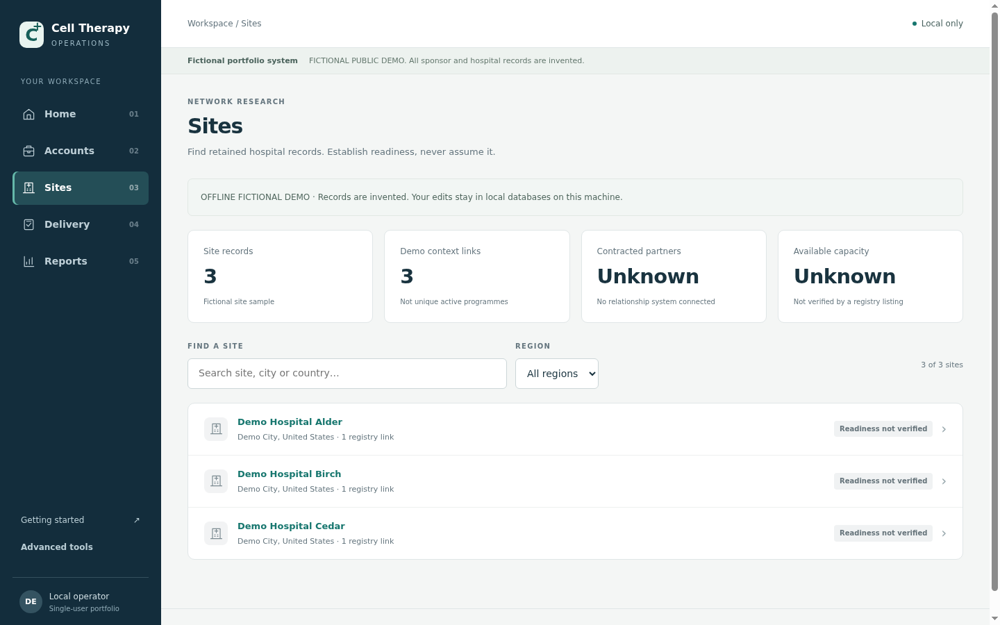
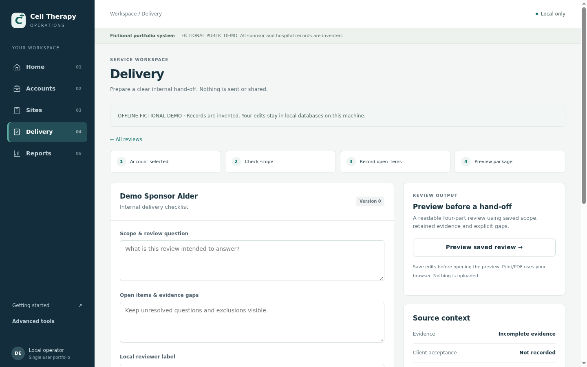

# Use the fictional demo

The main README covers first-run setup. Keep the server on loopback. Every sponsor, hospital and practice scenario in this public candidate is invented.

## 1. Start with an open question

Open Home and choose the task for Demo Sponsor Alder. Home is a starting point, not a claim of lead quality or business performance.

## 2. Plan without rewriting the evidence

In Accounts, open Demo Sponsor Alder, then Work & planning. Try:

- Next evidence step: `Fictional practice: establish who owns the programme hand-off.`
- Blocker: `No externally verified source has been supplied.`
- Planning note: `Practice record only. Do not contact anyone.`

Save and look for confirmation. Return to the account and check the note remains. The planning store is separate from source-owned work. If an old tab tries to save a stale version, reload, compare the current note and then apply only the changes you still intend. Do not treat a conflict as success.

## 3. Inspect missing evidence

Evidence and People are intentionally incomplete. These fixtures contain no real buyer, named contact, current clinical programme or verified outreach trigger. The draft views do not invent a send-ready sales message from that gap.

The separate fictional reply-practice tool is a fixed scenario exercise, not a live inbox or model-powered reply service.

## 4. Inspect a site, do not certify it

In Sites, select Demo Hospital Alder. Its linked trial identifier is a DEMO identifier, not a real registry number. Assessment axes start Grey. The blank evidence is deliberate. Do not claim a real hospital has capacity or readiness based on this demo.

## 5. Prepare the internal hand-off

In Delivery, choose Demo Sponsor Alder. Enter a practice scope, list open questions and add a local reviewer label. Save before using the preview link. The preview reflects saved values, not unsaved form text.

The checklist supports internal review. It does not contact a customer, sign an agreement or establish client acceptance. Only mark internal checks complete if that is what your fictional exercise actually establishes.

## 6. Inspect local history

Reports and advanced planning captures show recorded local activity. Manual captures are sequential reads, not a perfect atomic snapshot of all modules. A historical date window does not reconstruct evidence as it existed then. Outcomes such as revenue are not measured.

## Stop, restart and recover

Press Ctrl+C to stop. Run `bash run.sh` again to keep your local records. No reset button is promised. If you want a fresh demo, close the server and move the four runtime DB files, plus any SQLite WAL/SHM companions, into a private backup folder before bootstrapping again. Never delete unfamiliar data as a troubleshooting shortcut.

The app has no login or shared staff permissions. Do not put private customer or patient information into it.
